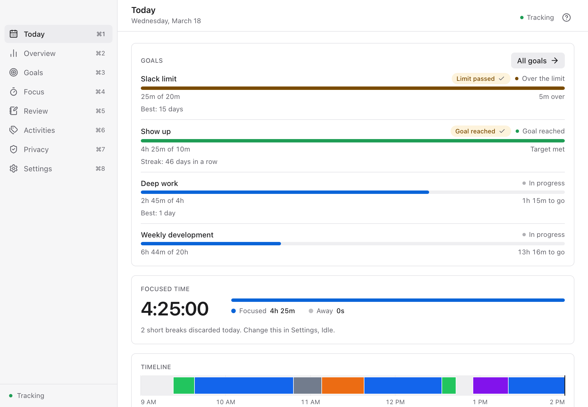
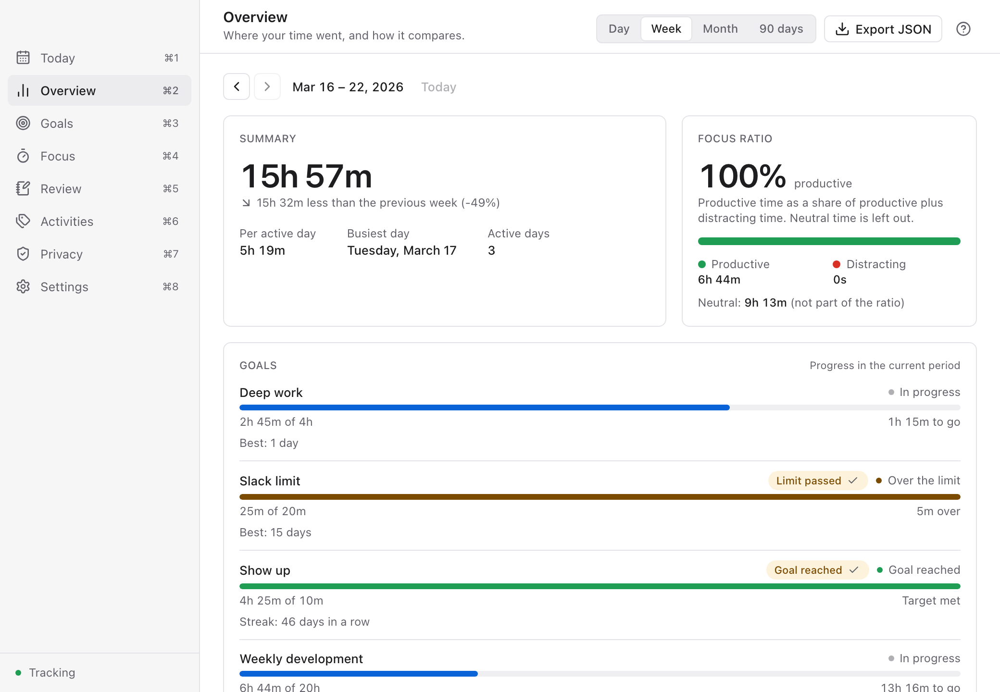
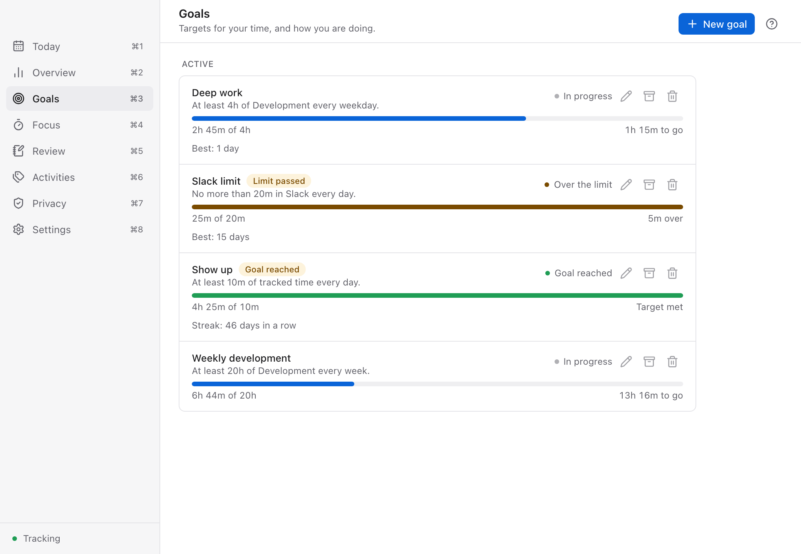

# Time Track Copilot

[](https://github.com/CarlosLeonCode/time-track-copilot/actions/workflows/ci.yml)
[](LICENSE)
[](#platform-status)

**A local-first time tracker you can fork and customize, by hand or with AI coding agents
(Claude Code, Antigravity, Cursor, etc.).**

Time Track Copilot lives in your menu bar and records which app and window you use, so you can
see where your day actually goes. No timers, no account, no cloud: your data stays on your
computer.

<picture>
  <source media="(prefers-color-scheme: dark)" srcset="website/src/assets/screenshots/today-dark.png">
  
</picture>

<p>
  <picture>
    <source media="(prefers-color-scheme: dark)" srcset="website/src/assets/screenshots/overview-dark.png">
    
  </picture>
  <picture>
    <source media="(prefers-color-scheme: dark)" srcset="website/src/assets/screenshots/goals-dark.png">
    
  </picture>
</p>

## Features

- **Automatic tracking** of the app in front and, with permission, its window title
- **Menu bar popover** with today's total, the current app and pause/resume
- **Today** timeline colored by activity; **Overview** by day, week, month and 90 days
  (trends, busiest hours, focus ratio)
- **Activities and rules** by app or window-title pattern, flagged productive, neutral or
  distracting
- **Goals** (minimums or limits) with streaks, and **focus sessions** with drift alerts
- **Weekly review**, with an optional AI analysis (Claude, Gemini, OpenAI or a local Ollama)
- **Idle detection**: discard or assign the time you were away
- **Export and backups**: JSON export, daily local backup, one-step restore
- Light and dark themes, keyboard shortcuts, accessible UI

## Privacy

- Reads only the frontmost app name and, with Accessibility permission, its window title.
- Never requests Screen Recording; never reads keystrokes, clipboard or file contents.
- Stores everything in a local SQLite database
  (`~/Library/Application Support/com.carlosleon.timetrack/` on macOS).
- Exclude apps, hide titles, delete any range or everything.
- Nothing leaves your device, except two things you control: the update check (only when
  updates are enabled for the build) and the AI weekly review if you turn it on and run it
  (you see a preview first; API keys stay in the OS keychain).

## Install (macOS)

1. Download the latest `.dmg` from
   [Releases](https://github.com/CarlosLeonCode/time-track-copilot/releases/latest).
2. Open it and drag **Time Track Copilot** to **Applications**.
3. **First open.** The app is free and **not notarized by Apple**, so macOS warns that it
   cannot verify the developer. Click **Done**, then:
   - **macOS 15 (Sequoia) or later:** open **System Settings → Privacy & Security**, scroll to
     **Security**, click **Open Anyway** next to the message about Time Track Copilot, and
     confirm.
   - **macOS 13 and 14:** in Finder, right-click (or Control-click) the app in Applications,
     choose **Open**, then **Open** again.
4. Grant **Accessibility** when asked (System Settings → Privacy & Security → Accessibility)
   so window titles are recorded. Without it, only app names are recorded.

<details>
<summary>Advanced: remove the quarantine flag instead</summary>

Only if you trust the download. This skips the Gatekeeper check for this app:

```sh
xattr -dr com.apple.quarantine "/Applications/Time Track Copilot.app"
```

</details>

Each release's notes say whether that build keeps the Accessibility permission across updates
and whether it updates itself. See [docs/release.md](docs/release.md) for how releases are
signed.

## Platform status

| Platform | Status |
|---|---|
| macOS 13+ (Apple silicon and Intel) | **Released**: universal DMG on GitHub Releases |
| Windows 10/11 | Implemented, **coming soon** as a download. Build from source today. |
| Linux (X11) | Implemented, **coming soon** as a download. Build from source today. |
| Linux (Wayland) | Partial: idle, lock and sleep only (Wayland hides the active window) |

Details per capability: [docs/platform-support.md](docs/platform-support.md). Want a Windows or
Linux build sooner? Say so in [Issues](https://github.com/CarlosLeonCode/time-track-copilot/issues).

## Build from source

Requirements: Rust 1.93+, Node.js 22.12+, and the platform toolchain (Xcode command line tools
on macOS; WebKitGTK packages on Linux, see [docs/platform-support.md](docs/platform-support.md);
WebView2 and MSVC build tools on Windows).

```bash
npm install
npm run tauri dev       # run the app
npm run dev:mock        # UI only with an in-memory backend, no Rust build
npx tauri build         # your own installer for the current OS
```

With `dev:mock`, open `http://localhost:1420/main.html` or `http://localhost:1420/popover.html`.

On macOS the Accessibility grant is tied to the app's signature; under `tauri dev` it goes to
your terminal. To test permissions, sign a local build with a stable identity:
[scripts/create-dev-identity.md](scripts/create-dev-identity.md) and `scripts/dev-sign.sh`.

Tests:

```bash
cargo test --workspace
npm test
npm run e2e
```

## Fork it and make it yours (with AI agents)

This project is designed as a forkable base. The code follows a hexagonal architecture with a
pure domain, explicit ports and one adapter crate per OS, so changes stay local and testable,
which is exactly what AI coding agents need.

- [AGENTS.md](AGENTS.md): architecture map, invariants, the end-to-end recipe for a new
  feature and the exact verification commands. Claude Code reads it through
  [CLAUDE.md](CLAUDE.md); Antigravity, Cursor, Codex and others read `AGENTS.md` directly.
- [docs/forking.md](docs/forking.md): rebrand checklist (name, bundle id, icons, updater key,
  landing), customization ideas and example prompts.

Example prompt: *"Read AGENTS.md. Add a CSV export of totals per activity for a date range,
following the end-to-end recipe, and run all verification commands."*

## Project layout

| Path | Contents |
|---|---|
| `crates/domain` | Pure rules: segments, state machine, idle gaps, activities, goals, focus, privacy |
| `crates/application` | Ports, the engine thread, queries, commands, export, backup, review |
| `crates/adapters-sqlite` | SQLite schema, migrations and repositories |
| `crates/adapters-common` | Platform-neutral sampler core, idle edges, signal fan-out, keychain |
| `crates/adapters-ai` | Opt-in AI review providers (Anthropic, OpenAI, Gemini, Ollama) |
| `crates/adapters-macos` | NSWorkspace, Accessibility, idle, lock and permission adapters |
| `crates/adapters-windows` | Win32 foreground window, WinEvent hook, idle, lock and power |
| `crates/adapters-linux` | X11 (`x11rb`) focus and idle, logind over D-Bus, Wayland detection |
| `src-tauri` | Tauri shell: composition root, typed IPC, tray, windows, updater |
| `src` | React UI: popover, main window, onboarding (features split into containers and components) |
| `e2e` | Playwright tests against the mocked backend |
| `website` | Landing page (Astro, English and Spanish), see [website/README.md](website/README.md) |
| `docs` | Release, platform support, forking guide, checklists |

The original Electron prototype is preserved at the `electron-final` tag.

## Contributing

Contributions are welcome. Read [CONTRIBUTING.md](.github/CONTRIBUTING.md) and the
[Code of Conduct](.github/CODE_OF_CONDUCT.md). Report security issues privately as described
in [SECURITY.md](.github/SECURITY.md).

If the project is useful to you, a star on GitHub helps others find it.

## License

[MIT](LICENSE) © 2025-2026 Carlos León. You can use, modify and redistribute it, including for
commercial work, as long as the copyright and license notice are kept.
